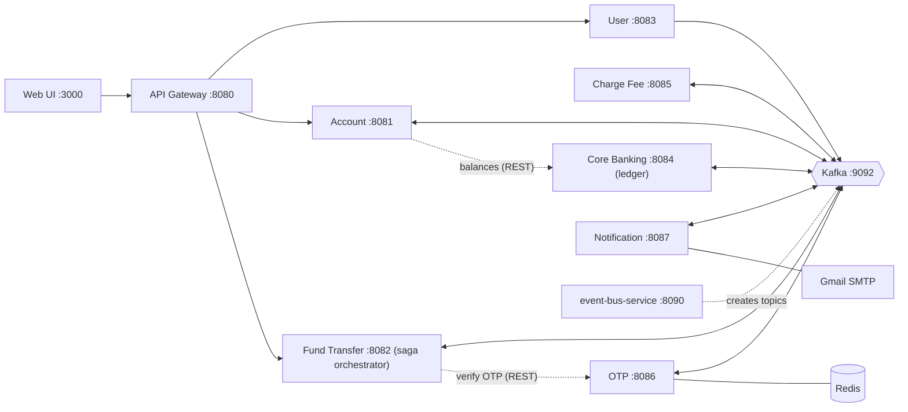
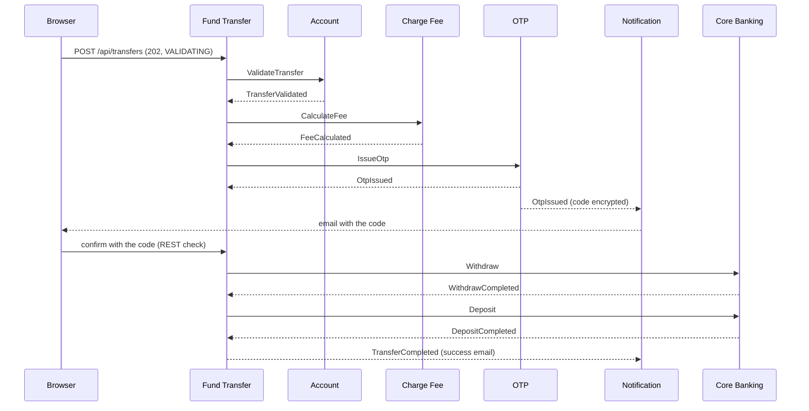

# Banking Microservices

An event-driven banking platform built with **Spring Boot, Apache Kafka, Redis, and PostgreSQL**.
Customers register, open accounts, transfer money, deposit, and withdraw. Every money movement is a
**saga with automatic reversal**, protected by a transactional outbox, deduplication, idempotent handlers,
retries, dead-letter topics, and circuit breakers. Everything is observable in Grafana: metrics, logs, and traces.

 
 


> A learning and demo project, not production banking software. See [Known limitations](#known-limitations).

<!--
## Demo

**Demo video:** [Watch the demo](YOUR_DEMO_VIDEO_LINK)

| Transfer in progress | Trace of one transfer | Traffic dashboard |
|---|---|---|
|  |  |  |
-->

## What it does

- **Accounts:** open accounts (created asynchronously by the ledger), see balances
- **Transfers:** between your own accounts (free) or to other customers (flat fee), confirmed with a one-time password sent by email
- **Cash:** deposit (no OTP by default) and withdraw (with OTP)
- **Safety:** if the deposit fails after the withdrawal, the saga **reverses** it and refunds amount and fee
- **Honest screens:** the web UI follows each request, resumes after a reload, and never says "failed" when money is only delayed

## Architecture



**Rule of thumb:** anything that changes state goes through Kafka. Quick reads and the OTP check (the user is waiting) use REST.
**Core Banking is the only owner of balances.** Each service has its own database. Eureka handles service discovery.

## A transfer, step by step



- 12 saga states: `VALIDATING → FEE_PENDING → OTP_PENDING → AWAITING_OTP → WITHDRAWING → DEPOSITING → COMPLETED`,
  and the exits `FAILED`, `EXPIRED`, `REVERSING → REVERSED`, `RECONCILIATION_REQUIRED`
- Money passes through a **transit account**, so its location is always known (it is zero when nothing is running)
- Silent services: the saga resends the same command (safe), then hands the transfer to a person. A late answer heals it

## How the hard problems are solved

| Problem | Solution |
|---|---|
| Saving data and publishing an event can disagree | **Transactional outbox**: the event is saved in the same database transaction, then relayed to Kafka |
| Kafka delivers a message twice | **Deduplication**: every consumer remembers `eventId`s (`processed_events`, `command_results`, Redis marker). Idempotent producer on the sending side |
| Running a command twice must not move money twice | **Idempotency**: command ids `<transferId>:WITHDRAW/DEPOSIT/REVERSAL`, one settlement row (deposit **or** reversal), unique ledger references, a state machine that ignores wrong-state events |
| A message keeps failing | Retries after 1, 2, 4, 8 s, then a **dead-letter topic** (`<topic>.DLT`). Malformed and permanent failures skip the retries |
| A service does not answer | Timeouts, resend with the same command id, escalation to `RECONCILIATION_REQUIRED` |
| A downstream service is sick | **Resilience4j** circuit breaker, retry only for safe reads, five classified error kinds (`DOWNSTREAM_TIMEOUT`, `DOWNSTREAM_UNAVAILABLE`, `DOWNSTREAM_BAD_RESPONSE`, `CIRCUIT_OPEN`, refused), graceful "balance unavailable" |
| Gmail fails | Permanent (wrong password) goes straight to the dead-letter topic, temporary keeps the retries |
| OTP safety | **Redis**: HMAC-hashed code, 5 min TTL, 3 attempts, atomic Lua verification (works once), 30 s resend cooldown |

## Observability

| Pillar | Tool | What you see |
|---|---|---|
| Metrics | Prometheus + Grafana | 7 dashboards, 20 alert rules (transfers, messaging, ledger, security, communication) |
| Logs | Loki (via Alloy) | JSON logs of all services, filter by transfer id or trace id |
| Traces | OpenTelemetry + Tempo | One trace tree across gateway, services, Kafka, and the outbox, searchable by transfer id |
| Requests and messages | Spring AOP | Sanitized request/response, Kafka messages in and out, and calls between services |

Every response has an `X-Trace-Id` header, and every error has a `code` and a `traceId`.

## Security

- **JWT** is checked only at the gateway. It removes client-supplied `X-User-*` headers, and `/internal/**` is never exposed
- OTP codes and tokens inside Kafka events are **AES-GCM encrypted**. Codes are stored only as keyed hashes
- Logs mask secrets by field name (`password`, `otp`, `token`, ...), and the notification bodies are never logged
- Secrets live in environment variables (`run.env`, never committed)

## Tech stack

Java 17 · Spring Boot 3.5.5 · Spring Cloud 2025.0.0 (Gateway, Eureka) · Apache Kafka (KRaft) + Kafka UI · PostgreSQL ·
Redis · Resilience4j · Spring AOP · Micrometer · OpenTelemetry · Prometheus · Grafana · Loki · Tempo · Alloy ·
Docker Compose (infrastructure) · plain HTML and JavaScript web UI · Gmail SMTP

## Repositories

Each service has its own repository. This repository is the entry point.

| Service | Port | Data | What it does | Repository |
|---|---|---|---|---|
| **api-gateway** | 8080 | none | JWT check, routing, timeouts | [repo](https://github.com/Md-Jahid-Hasan-10/api-gateway) |
| **discovery-service** | 8761 | none | Eureka service registry | [repo](https://github.com/Md-Jahid-Hasan-10/discovery-service) |
| **user-service** | 8083 | `user_db` | Registration, login, email verification | [repo](https://github.com/Md-Jahid-Hasan-10/user-service) |
| **account-service** | 8081 | `account_db` | Account ownership and status | [repo](https://github.com/Md-Jahid-Hasan-10/account-service) |
| **fund-transfer-service** | 8082 | `fund_transfer_db` | The saga orchestrator | [repo](https://github.com/Md-Jahid-Hasan-10/fund-transfer-service) |
| **core-banking-service** | 8084 | `cbs_db` | The ledger: the only owner of balances | [repo](https://github.com/Md-Jahid-Hasan-10/core-banking-service) |
| **charge-fee-service** | 8085 | none | Fee calculation | [repo](https://github.com/Md-Jahid-Hasan-10/charge-fee-service) |
| **otp-service** | 8086 | Redis | Creates and checks one-time passwords | [repo](https://github.com/Md-Jahid-Hasan-10/otp-service) |
| **notification-service** | 8087 | `notification_db` | Emails (OTP, results) | [repo](https://github.com/Md-Jahid-Hasan-10/notification-service) |
| **event-bus-service** | 8090 | none | Creates the Kafka topics, holds the Docker Compose files, monitoring, and docs | [repo](https://github.com/Md-Jahid-Hasan-10/event-bus-service) |
| **banking-web-ui** | 3000 | none | Web UI, smoke test | [repo](https://github.com/Md-Jahid-Hasan-10/banking-web-ui) |

Management ports (`/actuator/health`, `/actuator/prometheus`) are the application port plus 10000, for example 18082.

## Run it locally

**Prerequisites:** Java 17+, Maven, Docker, Python 3 (serves the UI), Node 18+ (smoke test), and a Gmail account with an
[app password](https://support.google.com/accounts/answer/185833).

**1. Clone everything into this folder**

```
git clone https://github.com/Md-Jahid-Hasan-10/banking-microservices.git
cd banking-microservices
git clone https://github.com/Md-Jahid-Hasan-10/api-gateway.git
git clone https://github.com/Md-Jahid-Hasan-10/discovery-service.git
git clone https://github.com/Md-Jahid-Hasan-10/user-service.git
git clone https://github.com/Md-Jahid-Hasan-10/account-service.git
git clone https://github.com/Md-Jahid-Hasan-10/fund-transfer-service.git
git clone https://github.com/Md-Jahid-Hasan-10/core-banking-service.git
git clone https://github.com/Md-Jahid-Hasan-10/charge-fee-service.git
git clone https://github.com/Md-Jahid-Hasan-10/otp-service.git
git clone https://github.com/Md-Jahid-Hasan-10/notification-service.git
git clone https://github.com/Md-Jahid-Hasan-10/event-bus-service.git
git clone https://github.com/Md-Jahid-Hasan-10/banking-web-ui.git
```

**2. PostgreSQL and Redis** (use your own passwords)

```
docker run -d --name banking-postgres -e POSTGRES_USER=banking_admin -e POSTGRES_PASSWORD=change-me -p 127.0.0.1:5433:5432 postgres:16
docker run -d --name banking-redis -p 127.0.0.1:6379:6379 redis:7 redis-server --requirepass change-me
docker exec -it banking-postgres psql -U banking_admin -d postgres -c "CREATE DATABASE user_db;"
docker exec -it banking-postgres psql -U banking_admin -d postgres -c "CREATE DATABASE notification_db;"
docker exec -it banking-postgres psql -U banking_admin -d postgres -c "CREATE DATABASE cbs_db;"
docker exec -it banking-postgres psql -U banking_admin -d postgres -c "CREATE DATABASE account_db;"
docker exec -it banking-postgres psql -U banking_admin -d postgres -c "CREATE DATABASE fund_transfer_db;"
```

**3. Secrets.** Copy `run.env.example` to `run.env` and fill it in (never commit `run.env`):

| Variable | Used by | Purpose |
|---|---|---|
| `DB_PASSWORD` | services with a database | PostgreSQL password |
| `REDIS_PASSWORD` | otp-service | Redis password |
| `MAIL_USERNAME`, `MAIL_PASSWORD` | notification-service | Gmail address and app password |
| `EVENT_CRYPTO_KEY` | user, otp, notification | Shared AES key: `openssl rand -base64 32` |
| `GRAFANA_ADMIN_PASSWORD` | monitoring | Grafana login |
| `JWT_SECRET` | gateway, user | Optional, must be identical in both |

Also put `GRAFANA_ADMIN_PASSWORD=...` into `event-bus-service/.env` for Docker Compose.

**4. Kafka and monitoring**

```
mkdir -p ~/banking-logs
cd event-bus-service
docker compose -f docker-compose.yml -f docker-compose.monitoring.yml up -d
cd ..
```

**5. Start the services**

```
./run-all.sh --build     # first time
./run-all.sh             # later
./stop-all.sh            # stop everything
```

| What | Address |
|---|---|
| Web UI | http://localhost:3000 |
| Eureka | http://localhost:8761 |
| Kafka UI | http://localhost:8089 |
| Prometheus (targets, alerts) | http://localhost:9090 |
| Grafana (dashboards, logs, traces) | http://localhost:3001 |

**6. Try it:** register two users, open accounts (they show "Opening..." until the ledger answers), transfer to the other
user, enter the code from the email, and watch it in Grafana. Automated check: `node banking-web-ui/smoke-test.js`
(start otp-service with `OTP_LOG_DEV=true` so the script can read the codes in its log).

## Tests and failure drills

- Unit tests in every service: `mvn test` in each folder (state machines, handlers, aspects, error classification, circuit breaker, mail failures)
- `banking-web-ui/smoke-test.js`: registers users, transfers, deposits, withdraws, and checks the balances
- **14 failure drills** (Kafka down, Core Banking down, receiver cannot be credited, poison message, wrong Gmail password, ...) in the failure-drills document
- Ledger integrity queries: every balance equals the sum of its entries, the transit account is zero at rest, no duplicate references

## Documentation

All documents are in [`event-bus-service/docs`](https://github.com/Md-Jahid-Hasan-10/event-bus-service/tree/main/docs):

| Document | Content |
|---|---|
| `event-contract.md` | Topics, envelope, payloads, reason codes |
| `api-contract.md` | REST endpoints and the error format |
| `monitoring.md` | Dashboards, metrics, logs, traces |
| `runbook.md` | Alerts, replaying dead letters, reconciliation of a stuck transfer |
| `failure-drills.md` | The 14 drills and what to expect |
| `demo-script.md` | A 12-minute demo script |

## Known limitations

- Demo scope: no fraud checks, transaction limits, or audit screens. Reconciliation of a stuck transfer is done by hand (runbook)
- One Kafka broker, one PostgreSQL, one Redis, one Eureka, single service instances, replication factor 1
- Internal endpoints have no authentication of their own. They are protected because the gateway never exposes them
- JWT uses one shared secret and has no refresh or revocation
- Delivery is at least once. A crash can send an email twice, never lose one
- Metrics are for watching, the ledger is the truth. There is no Alertmanager, so alerts are visible but not sent
- A timeout during the OTP check can use up a correct code (the customer presses "Resend code")
- No REST `Idempotency-Key` header yet. The Kafka side is complete

## Author

**Jahid Hasan**
B.Sc. in Information and Communication Technology, Jahangirnagar University

[GitHub](https://github.com/Md-Jahid-Hasan-10) · [LinkedIn](https://www.linkedin.com/in/jahid-hasan-jhs/)
